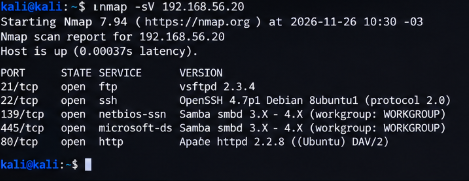

Auditoria de Segurança: Ataques de Força Bruta com Kali Linux e Medusa

Sobre o Projeto

Este projeto foi desenvolvido como parte do desafio prático da Digital Innovation One (DIO), com o objetivo de estudar e demonstrar como funcionam os ataques de força bruta (Brute Force) em ambientes controlados de segurança da informação.

A atividade utiliza o Kali Linux, a ferramenta Medusa e ambientes vulneráveis, como Metasploitable 2 e DVWA, para compreender vulnerabilidades relacionadas à autenticação e identificar formas de proteger sistemas contra tentativas indevidas de acesso.

Todos os testes descritos neste projeto devem ser realizados exclusivamente em laboratório próprio, isolado e autorizado.

Objetivos

Compreender o funcionamento dos ataques de força bruta.

Conhecer e utilizar a ferramenta Medusa.

Identificar vulnerabilidades em serviços FTP, SMB e aplicações Web.

Realizar testes controlados de autenticação.

Entender os riscos de senhas fracas e reutilizadas.

Aprender técnicas de prevenção contra ataques de força bruta.

Documentar procedimentos técnicos e resultados.

1. Ambiente de Laboratório

Para a realização dos testes, foi planejado um ambiente virtualizado utilizando o VirtualBox.

Ferramentas utilizadas

Ferramenta

Finalidade

Kali Linux

Sistema operacional para auditoria de segurança

Medusa

Ferramenta de auditoria de autenticação

Metasploitable 2

Máquina virtual vulnerável para testes

DVWA

Aplicação Web vulnerável para estudos

VirtualBox

Virtualização das máquinas

Nmap

Identificação de portas e serviços

Wordlists

Listas de senhas para testes controlados

Configuração da rede

As máquinas virtuais devem utilizar uma rede isolada, preferencialmente Host-Only ou Rede Interna, sem exposição dos serviços vulneráveis à internet.

Estrutura do laboratório:

Máquina 1: Kali Linux (máquina de auditoria).

Máquina 2: Metasploitable 2 (máquina de testes).

Aplicação DVWA: ambiente Web vulnerável acessível somente pelo laboratório.

Exemplo de endereçamento

Kali Linux: 192.168.56.10

Metasploitable 2: 192.168.56.20

Os endereços são ilustrativos e devem ser substituídos pelos IPs reais das máquinas virtuais.

2. Identificação de Serviços com Nmap

O primeiro passo de uma auditoria é identificar os serviços disponíveis na máquina de testes.

Comando:

nmap -sV 192.168.56.20

O parâmetro -sV permite identificar versões dos serviços encontrados.

Entre os serviços que podem ser analisados estão:

FTP – Porta 21.

SSH – Porta 22.

SMB – Portas 139 e 445.

HTTP – Porta 80.

A identificação dos serviços permite compreender quais pontos precisam ser avaliados durante a auditoria.

3. Ataque de Força Bruta em FTP

Conceito

O FTP (File Transfer Protocol) é um protocolo utilizado para transferência de arquivos entre computadores.

Um serviço FTP mal configurado, principalmente quando utiliza senhas fracas ou não possui mecanismos de bloqueio, pode estar vulnerável a tentativas repetidas de autenticação.

Preparação da wordlist

Criar uma lista pequena de senhas para utilização exclusiva no laboratório:

nano senhas.txt

Exemplo de conteúdo:

123456
admin
password
12345
msfadmin
qwerty

Salvar o arquivo.

Teste com Medusa

Primeiro, verificar se o módulo FTP está disponível:

medusa -d

Comando de auditoria para o serviço FTP da máquina vulnerável:

medusa -h 192.168.56.20 -u msfadmin -P senhas.txt -M ftp -t 1 -f

Descrição dos parâmetros:

-h: endereço IP do equipamento de laboratório.

-u: usuário utilizado no teste.

-P: arquivo contendo as senhas de teste.

-M: módulo FTP.

-t 1: execução com uma tarefa por vez.

-f: interrompe o teste após encontrar uma combinação válida.

Análise

O objetivo é verificar se o serviço permite autenticação utilizando senhas fracas e se existe algum mecanismo de proteção contra tentativas repetidas.

A validação deve ser realizada com uma conta de laboratório autorizada.

4. Teste de Autenticação em Aplicação Web (DVWA)

Conceito

A DVWA (Damn Vulnerable Web Application) é uma aplicação criada para ensinar e praticar conceitos de segurança em aplicações Web.

Ela possui um módulo chamado Brute Force, que permite estudar tentativas repetidas de autenticação.

Procedimento

Iniciar a aplicação DVWA no ambiente de laboratório.

Acessar a aplicação pelo navegador utilizando o endereço IP da máquina que hospeda o serviço.

Realizar a autenticação na aplicação.

Acessar a opção DVWA Security.

Selecionar o nível Low para o exercício controlado.

Acessar Vulnerabilities → Brute Force.

Realizar algumas tentativas manuais com credenciais de teste.

Observar as mensagens apresentadas pela aplicação.

Automação controlada

Para demonstrar a automação, pode-se utilizar uma pequena wordlist e o recurso Intruder do Burp Suite, limitando os testes ao formulário Brute Force da própria DVWA.

A requisição deve ser analisada para identificar:

Nome dos campos de usuário e senha.

Resposta apresentada quando a autenticação falha.

Resposta apresentada quando a autenticação é válida.

Existência de limite de tentativas.

Existência de bloqueio temporário.

Observação: a ferramenta Medusa é voltada principalmente a módulos de autenticação de serviços de rede. O formulário DVWA possui particularidades como sessão e cookies, por isso uma ferramenta de análise HTTP, como o Burp Suite, é mais adequada para esse cenário.

Análise

O exercício demonstra como aplicações sem proteção adequada podem ficar expostas a tentativas automatizadas de descoberta de senhas.

5. Password Spraying em SMB

Conceito

O SMB (Server Message Block) é um protocolo utilizado para compartilhamento de arquivos e recursos em redes.

O Password Spraying é uma técnica na qual uma senha é testada contra diferentes contas de usuários, em vez de testar muitas senhas contra apenas uma conta.

Essa técnica pode dificultar a identificação de ataques quando os mecanismos de monitoramento são inadequados.

Identificação do serviço

Utilizar o comando:

nmap -p 139,445 -sV 192.168.56.20

Enumeração de usuários

Em um laboratório autorizado, ferramentas como enum4linux podem auxiliar na identificação de informações disponíveis no serviço SMB.

Exemplo:

enum4linux -U 192.168.56.20

Também é possível verificar os compartilhamentos disponíveis:

smbclient -L //192.168.56.20 -N

Password Spraying com Medusa

Para demonstrar o conceito, utilizar uma lista pequena de contas de teste previamente criadas no ambiente.

Criar o arquivo:

nano usuarios.txt

Exemplo:

usuario1
usuario2
usuario3

Utilizar uma única senha de laboratório previamente definida:

medusa -h 192.168.56.20 -U usuarios.txt -p SenhaDeTeste123 -M smbnt -t 1

Importante: o módulo SMBNT deve estar disponível na instalação do Medusa. O teste deve ser realizado somente com contas próprias e previamente autorizadas.

Análise

O Password Spraying demonstra a importância de políticas de senhas fortes, monitoramento de autenticação e mecanismos de detecção de tentativas suspeitas.

6. Medidas de Prevenção

Após estudar os cenários apresentados, é possível identificar algumas medidas importantes para reduzir os riscos de ataques de força bruta.

FTP

Desabilitar o FTP quando não houver necessidade.

Preferir SFTP ou FTPS.

Utilizar senhas fortes.

Restringir o acesso por endereço IP.

Monitorar tentativas de autenticação.

Aplicações Web

Implementar limite de tentativas de login.

Utilizar CAPTCHA quando apropriado.

Implementar autenticação multifator (MFA).

Aplicar bloqueios temporários após várias falhas.

Utilizar HTTPS.

Registrar e monitorar tentativas de autenticação.

Evitar mensagens que revelem se um usuário existe.

SMB

Desabilitar versões antigas e inseguras do SMB.

Restringir o acesso às portas 139 e 445.

Utilizar senhas fortes e exclusivas.

Aplicar políticas de bloqueio de contas.

Monitorar eventos de autenticação.

Utilizar autenticação multifator quando disponível.

Recomendações gerais

A segurança da informação depende de uma combinação de boas práticas técnicas, políticas de acesso e monitoramento contínuo.

7. Resultados e Aprendizados

Os cenários propostos permitem compreender diferentes formas de exploração de falhas de autenticação.

Cenário

Vulnerabilidade estudada

Principal aprendizado

FTP

Senhas fracas

Importância da proteção de serviços de rede

DVWA

Falta de controle de tentativas

Necessidade de proteção em formulários Web

SMB

Password Spraying

Importância de monitoramento e políticas de senhas

Principais aprendizados

Durante o desenvolvimento deste projeto, foram estudados:

O funcionamento dos ataques de força bruta.

A utilização do Kali Linux como ambiente de auditoria.

A finalidade da ferramenta Medusa.

A identificação de serviços com Nmap.

A enumeração de usuários em ambientes SMB.

O funcionamento do Password Spraying.

A importância de wordlists em testes de autenticação.

As principais medidas de prevenção contra acessos indevidos.

Os resultados práticos de cada teste devem ser registrados após a execução no laboratório, com os respectivos comandos, evidências e observações.

8. Evidências do Projeto

Para complementar a documentação, recomenda-se adicionar capturas de tela dos procedimentos realizados.

Criar uma pasta chamada images no repositório.

9. Referências

Kali Linux: https://www.kali.org/

Medusa: http://www.foofus.net/jmk/medusa/medusa.html

DVWA: http://www.dvwa.co.uk/

Nmap: https://nmap.org/book/

GitHub: https://docs.github.com/

VirtualBox: https://www.virtualbox.org/

10. Conclusão

O desenvolvimento deste projeto proporcionou uma visão prática e conceitual sobre a importância da segurança dos mecanismos de autenticação.

Foi possível estudar como ataques de força bruta e Password Spraying podem explorar senhas fracas e falhas de configuração em serviços de rede e aplicações Web.

Além disso, o projeto reforça a importância da utilização de ferramentas como Kali Linux, Medusa e Nmap no processo de auditoria de segurança.

Conclui-se que a prevenção depende da adoção de boas práticas, como senhas fortes, autenticação multifator, controle de tentativas, monitoramento e atualização dos serviços.

A segurança da informação não depende apenas de identificar vulnerabilidades, mas também de compreender como preveni-las e proteger os sistemas.

Projeto desenvolvido para fins educacionais – Desafio DIO.

Evidências Demonstrativas

Abaixo está um painel ilustrativo dos cenários abordados neste projeto.

